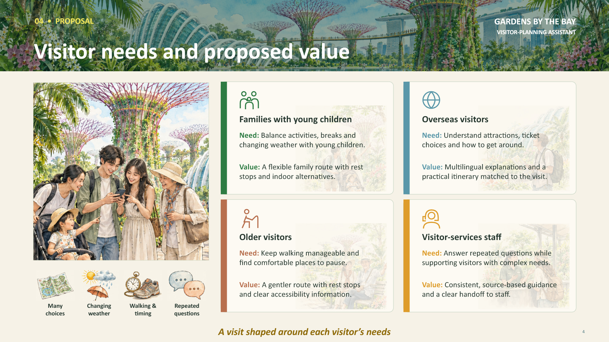

# Le_SensVisual (By TH_Ng)

**0.4.0-rc.23 - release candidate. Formerly VisuaSense.**

An agent skill for visual communication with a recognisable subject world,
meaningful imagery, supporting scenes, clear relationships and calm reading
space. TYY guides what the viewer sees and understands; the task determines
the format and tools. Use it for images, presentations, teaching material,
editorial pages, charts and interfaces.



This reference demonstrates coordinated composition. It is not evidence of
autonomous cross-host reliability. Read the [reference notes](le-sensvisual/examples/INDEX.md).

## Use with an agent

Install the single `le-sensvisual/` folder, preserving its subfolders. The entry
point is [SKILL.md](le-sensvisual/SKILL.md). From a downloaded or cloned repository:

```sh
python le-sensvisual/scripts/install.py --host codex
# Or:
python le-sensvisual/scripts/install.py --host claude-code
```

For another supported host, use its documented skills directory with
`--destination`. Recognised Codex/Claude legacy installations are backed up
outside discovery. See [installation and prerequisites](le-sensvisual/INSTALL.md).
Invoke `le-sensvisual` through the host's skill mechanism with your normal brief.

> Create a useful welcome guide for customers moving into their first HDB home.
> Help them prepare for moving week and understand moving day. Produce one image
> in English. Choose the remaining content and design decisions yourself.

The example brief is an invocation example, not a new evaluated result.

## What is included

- TYY core, eleven lenses, worked visual decisions and four bundled references.
- Production guidance and optional asset, PPTX, HTML and extraction helpers.
- Interface workflows for context, design systems, critique, accessibility,
  motion, responsive work, hardening and optimisation.
- HTML presentation tools with 12 presets and 34 detailed style systems.

All guidance and reference images are in the main skill. Load relevant sections
as needed. Existing large engine/source/browser/full-construction resources are
five pinned release companions, also available together in the offline bundle.
See the [capability map](le-sensvisual/CAPABILITIES.json).

## Ordinary chat apps

Use the release's **chat-guidance ZIP** where archive reading is supported: six
text sections, including SKILL.md and all specialist/style guidance, plus all four
images. The complete-guidance TXT provides the same written library without image
pixels; the images are also viewable in this repository. Ask the host to read the
entry and confirm access before sending the task. An attachment or URL does not
install tools or guarantee context loading. Gemini ZIP ingestion remains unverified.

## Status and limits

rc.23 sharpens the existing Haze teaching example to connect source, movement
and consequence within its visual world. Gardens stays first; NLB stays last.
No format is forced. All four image bytes and specialist capabilities remain.
Source/package reconciliation and local installation are recorded; no rc.23
model/output test was run. Earlier low-effort rc.19/rc.22 comparisons showed
strong worlds in both versions, without a clear overall winner. Improved
performance from this change remains unmeasured.

Actual tool access, supported operations and model attention vary by host.
Read [release status](le-sensvisual/RELEASE-STATUS.md) and
[release notes](RELEASE-NOTES.md) before use.

## Licence and credits

Original work by TH_Ng is [MIT](LICENSE). Adapted Impeccable work retains
Apache-2.0; Frontend Slides and bundled dependencies retain their respective
terms. See [licensing and credits](le-sensvisual/LICENSING.md). The original TYY
deck is not redistributed. No upstream endorsement is claimed.
